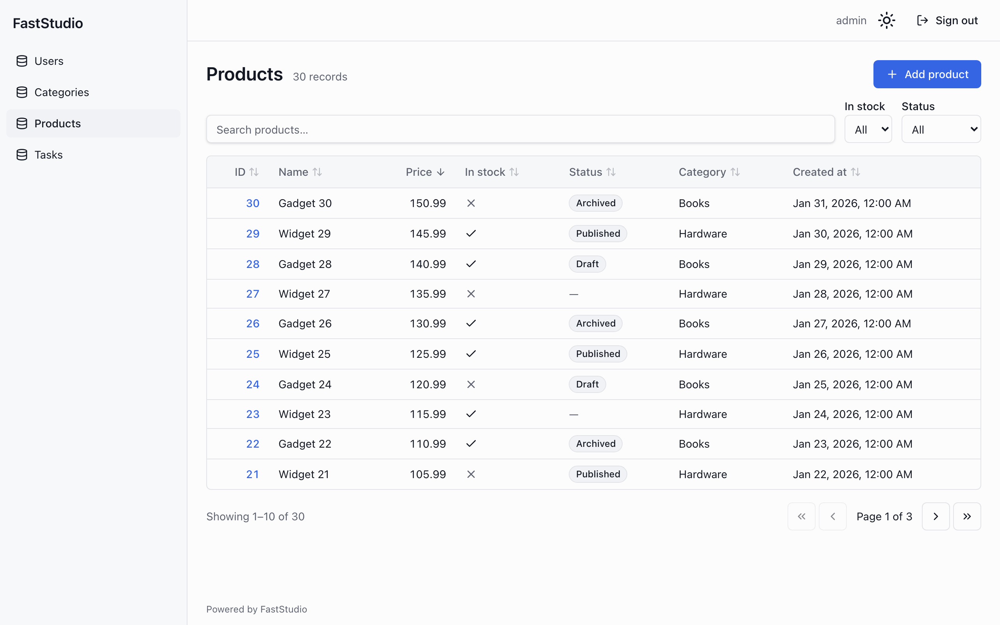
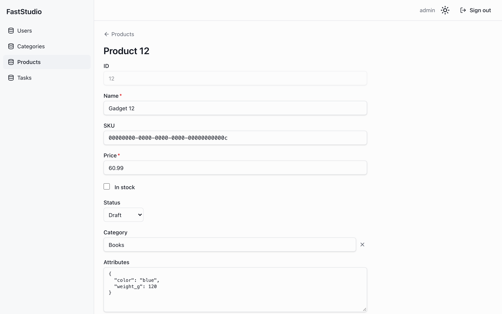
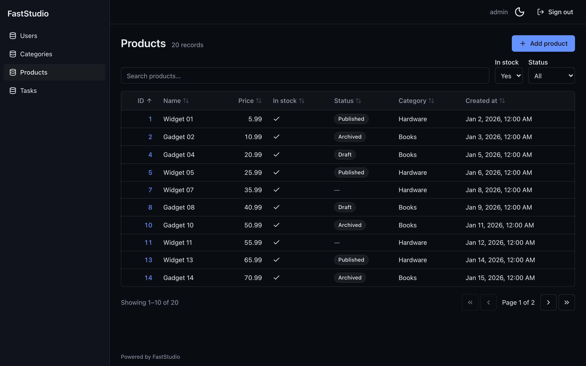

<p align="center"><strong>FastStudio</strong></p>

<p align="center"><em>A modern, beautiful admin studio for FastAPI.</em></p>

<p align="center">
  <a href="https://github.com/bekzod818/faststudio/actions/workflows/ci.yml"></a>
  <a href="https://codecov.io/gh/bekzod818/faststudio"></a>
  <a href="https://pypi.org/project/faststudio/"></a>
  <a href="https://pypi.org/project/faststudio/"></a>
  <a href="https://github.com/bekzod818/faststudio/blob/main/LICENSE"></a>
  <a href="https://github.com/astral-sh/ruff"></a>
</p>

> **Status: alpha.** The public API may change in any `0.x` release until `1.0`.

FastStudio adds a polished, Django-Admin-style admin panel to any FastAPI
application backed by SQLAlchemy 2.0 (async). Register your models with a few
lines of declarative Python and get a fast React UI for browsing, searching,
filtering and editing your data. No Node.js required: the UI ships pre-built
inside the Python wheel.

<p align="center">
  
</p>

## Features

- **pip install and go**: the React SPA is bundled in the wheel.
- **Declarative `ModelAdmin`**: `list_display`, `search_fields`, `list_filter`,
  `ordering`, `readonly_fields`, `exclude`, `can_create` / `can_edit` / `can_delete`.
- **Schema-driven UI**: tables and forms are generated from your SQLAlchemy
  models. No per-model frontend code.
- **Server-side everything**: pagination, sorting, search and filters run in
  the database through SQLAlchemy expressions, never string-built SQL.
- **Secure by default**: argon2 password hashing, signed HTTP-only session
  cookies, CSRF protection, login rate limiting, strict security headers and CSP.
- **Typed end to end**: `mypy --strict` clean, ships `py.typed`; the
  frontend's API types are generated from the backend's Pydantic contract.
- Light and dark mode, responsive layout, accessible components.

## Quickstart

```bash
pip install faststudio aiosqlite uvicorn   # aiosqlite: or asyncpg / "aiomysql[rsa]>=0.3"
```

Tested in CI with SQLite (Python 3.11–3.13, `aiosqlite`), PostgreSQL 17
(`asyncpg`) and MySQL 8.4 LTS (`aiomysql[rsa]`); see
[Databases](https://github.com/bekzod818/faststudio/blob/main/docs/configuration.md#databases).

Save as `main.py`:

```python
from fastapi import FastAPI
from sqlalchemy import String
from sqlalchemy.ext.asyncio import create_async_engine
from sqlalchemy.orm import DeclarativeBase, Mapped, mapped_column

from faststudio import Admin, ModelAdmin, ModelUserBackend


class Base(DeclarativeBase):
    pass


class User(Base):  # your own model: FastStudio signs admins in from it
    __tablename__ = "users"

    id: Mapped[int] = mapped_column(primary_key=True)
    username: Mapped[str] = mapped_column(String(150), unique=True)
    email: Mapped[str] = mapped_column(String(254))
    password_hash: Mapped[str] = mapped_column(String(255))
    is_active: Mapped[bool] = mapped_column(default=True)
    is_admin: Mapped[bool] = mapped_column(default=False)


engine = create_async_engine("sqlite+aiosqlite:///app.db")
app = FastAPI()
# secret_key defaults to the FASTSTUDIO_SECRET_KEY environment variable
admin = Admin(app, engine=engine, auth_backend=ModelUserBackend(User))


@admin.register
class UserAdmin(ModelAdmin, model=User):
    list_display = ["id", "username", "email", "is_active", "is_admin"]
    search_fields = ["username", "email"]
    list_filter = ["is_active", "is_admin"]
    exclude = ["password_hash"]  # never show or accept credentials
    can_create = False  # accounts are created with `faststudio createadmin`


async def create_tables() -> None:  # in a real project, use your migrations
    async with engine.begin() as conn:
        await conn.run_sync(Base.metadata.create_all)
    await engine.dispose()
```

Then create the table and your first admin, and start the app:

```bash
export FASTSTUDIO_SECRET_KEY="$(python -c 'import secrets; print(secrets.token_urlsafe(48))')"
python -c "import asyncio, main; asyncio.run(main.create_tables())"
faststudio createadmin --app main:admin   # asks for the username, email and password
uvicorn main:app
# open http://127.0.0.1:8000/admin
```

The [getting-started guide](https://github.com/bekzod818/faststudio/blob/main/docs/getting-started.md) explains each
step, and [`examples/basic`](https://github.com/bekzod818/faststudio/blob/main/examples/basic/README.md) is a complete
app covering every field type:

<p align="center">
  
  
</p>

## Configuration

| Option (`Admin(...)`) | Env var | Default | Notes |
|---|---|---|---|
| `secret_key` | `FASTSTUDIO_SECRET_KEY` | required | ≥ 32 chars, random. Startup fails if missing or weak. |
| `base_url` | – | `/admin` | Mount path. The UI works under any path. |
| `title` | – | `"FastStudio"` | Shown in the header and browser tab. |
| `session_max_age` | – | 8 hours | Absolute session lifetime (int seconds or `timedelta`). |
| `session_idle_timeout` | – | off | Also end sessions after this long without a request; active sessions slide. |
| `secure_cookies` | – | `True` | Chrome and Firefox accept secure cookies on `http://localhost` and `127.0.0.1`; elsewhere serve over HTTPS. |
| `max_page_size` | – | `100` | Upper bound for any list request and for `ModelAdmin.page_size`. |
| `max_list_offset` | – | `10_000` | Lists stop paging after this many rows (deep `OFFSET`s are slow); search, filter or sort to reach older rows. |
| `rate_limiter` | – | in-memory | Use a shared limiter when running several workers. |
| `show_powered_by` | – | `True` | "Powered by FastStudio" footer. |
| `sync_permissions_on_startup` | – | `False` | Create missing permissions on the first admin request (backends with a permission schema, e.g. `contrib.auth`); never deletes. |

Full reference: [docs/configuration.md](https://github.com/bekzod818/faststudio/blob/main/docs/configuration.md).

## Security

FastStudio treats the admin as a high-value target. Every API route except
login requires a session; state-changing requests require a CSRF token; search,
filter and sort parameters are validated against the fields you declared;
writes respect `readonly_fields` and `exclude`; logins are throttled per
account and per client. Run behind a proxy with trusted proxy headers
(`uvicorn --proxy-headers --forwarded-allow-ips=...`) so client addresses are
real, and mount the admin on its own subdomain if the host serves untrusted
content. Read the
[threat model](https://github.com/bekzod818/faststudio/blob/main/docs/threat-model.md) and report vulnerabilities privately as
described in [SECURITY.md](https://github.com/bekzod818/faststudio/blob/main/SECURITY.md).

## How it compares

FastStudio stands on the shoulders of excellent existing projects:

- **[SQLAdmin](https://github.com/aminalaee/sqladmin)** is a mature, widely used
  admin for SQLAlchemy built on Starlette with server-rendered Jinja2
  templates. It supports sync and async engines and offers many more features
  than FastStudio does today.
- **[Starlette-Admin](https://github.com/jowilf/starlette-admin)** is a flexible
  admin framework supporting several ORMs/ODMs (SQLAlchemy, SQLModel,
  MongoEngine, ODMantic, Beanie), with file handling and data export, using
  server-rendered templates.

FastStudio takes a different approach: a **single-page React application**
driven by a versioned JSON metadata contract, with a typed REST API between
them. It is narrower in scope (SQLAlchemy 2.0 async only) and younger. If you
need a proven tool today, both projects above are great choices.

## Roadmap

See [ROADMAP.md](https://github.com/bekzod818/faststudio/blob/main/ROADMAP.md). Highlights after v0.1.0: relationship editing,
custom actions, file uploads, role-based permissions, audit log, i18n
(English, Uzbek, Russian).

## Contributing

Contributions are welcome. Start with [CONTRIBUTING.md](https://github.com/bekzod818/faststudio/blob/main/CONTRIBUTING.md) and
the [architecture overview](https://github.com/bekzod818/faststudio/blob/main/docs/architecture.md).

## License

[MIT](https://github.com/bekzod818/faststudio/blob/main/LICENSE) © 2026 Bekzod
