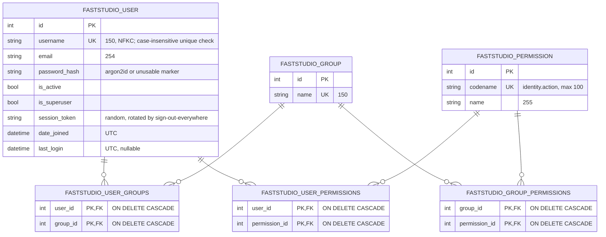

# FastStudio v0.2.0 plan: relationships, users and permissions

- **Status:** Approved by the maintainer on 2026-11-25, with amendments
  A1–A7 (section 9), which are folded into the sections below and into
  ADRs 0010–0013.
- **Baseline:** v0.1.1 (`c0d6fa1`), ADRs 0001–0009.
- **New ADRs** (Accepted 2026-11-25):
  - 0010 many-to-many fields;
  - 0011 backend capabilities, authorization and `contrib.auth`;
  - 0012 CLI;
  - 0013 session improvements.
- **Amended on acceptance:**
  - ADR-0004: backends now manage users through capabilities, and core
    still owns sessions;
  - ADR-0009: made public in the capability form;
  - threat model: T2 (FastStudio may write to the user table through an
    explicit capability) and a new T9 Authorization section.

## 1. Goals, constraints, non-goals

**Goals:**
- many-to-many fields;
- an optional Django-style `faststudio.contrib.auth`;
- authorization on every route;
- the `faststudio` CLI;
- idle timeout and "sign out everywhere";
- docs, `examples/rbac`, and backward-compatibility proof.

**Hard constraints:**
1. v0.1 code with `ModelUserBackend` keeps working and behaving the same:
   every active admin keeps full access, and no new HTTP write path appears
   (the password endpoints are opt-in for that backend).
   - The only visible differences are additive response keys:
     - in `/meta`: `permissions.view`, `capabilities`,
       `account.set_password` (false) and `account.admin_flag`
       (`"is_admin"`);
     - on detail rows: `many_labels` and `truncated`, always present and
       empty when a model has no M2M fields.
   - Proven by a test that runs a pinned snapshot of the v0.1.0 README
     quickstart and `examples/basic` (taken before M19 rewrites them)
     against 0.2.0.
2. Nothing in `faststudio` core imports `faststudio.contrib`. Contrib
   depends only on public core API.
3. FastStudio never creates tables. The CLI does not either.
4. No new runtime dependency.
5. A host that changes nothing gets the v0.1 session cookie format (see
   ADR-0013), so rolling deploys and downgrades keep sessions.

**Non-goals (v0.3+):**
- association objects with extra editable columns, and inline editing;
- custom actions;
- a field/widget registry;
- an audit log;
- a server-side session store;
- shared rate limiters;
- **row-level filtering of lists**, which needs a list-query hook.

## 2. Decisions (ADRs)

### ADR-0010 Many-to-many fields

**Which relationships count:** a `relationship()` with a plain secondary.
- Sides are detected from `synchronize_pairs` and
  `secondary_synchronize_pairs`, so self-referential M2M works.
- The secondary has exactly two FK columns, each referencing the
  single-column PK of one side.
- Any other column must have a server or Python default.

**Opt-in exposure:**
- The field appears only when listed in the new option
  `ModelAdmin.many_to_many = ("tags",)`.
- Unlisted relationships stay invisible, as in v0.1, so an upgrade never
  exposes new writable fields.
- `contrib.auth`'s admins opt in themselves.
- `viewonly=True` makes the field readonly.

Not usable in `list_display`, search, filters or ordering in v0.2.

**Contract:**
- `FieldType` gains `"many_to_many"`.
- `FieldMeta.max_items` is new.
- Detail `Row` gains `many_labels: {field: {pk: label}}` and
  `truncated: [field]`.
- The value is a list of target PKs (FK wire form).
- List rows omit M2M fields.

**Bounds** (default 500 per field, configurable per field (A3):
`ModelAdmin.many_to_many_limits = {"tags": 2000}`, with values between 1 and
`MAX_RELATED_ITEMS_LIMIT = 10_000`):
- Reads use `LIMIT max_items + 1` and an explicit query, never lazy loading.
- If more links exist, the field is listed in `truncated`, and the server
  refuses writes to it (`422`).
- A write with more than `max_items` keys is also `422`.

**Writes:**
- They replace the set in the write's transaction.
- Added PKs are checked for existence (`422 foreign_key`).
- Only association rows change; target rows never do.

**Delete-rule amendment:** deleting a row removes its plain-secondary links
in the same transaction. The v0.1 "409 while related rows exist" rule stays
for all other relationships. Without this, deleting any `contrib.auth`
group, user or permission would always fail.

### ADR-0011 Capabilities, authorization, `contrib.auth`

**Capabilities.** One namespaced optional attribute,
`backend.faststudio_capabilities`, returns a frozen `BackendCapabilities`
whose fields are all optional:

| Field | Protocol | Used by |
|---|---|---|
| `account_guard` | `AccountGuard` (ADR-0009, now public) | write API |
| `permissions` | `PermissionBackend` | every route |
| `user_admin` | `UserAdmin` | CLI, password endpoints |
| `session_revocation` | `SessionRevocation` | sign-out-everywhere |
| `register_admins` | `Callable[[Admin], None]` | `Admin(...)` at mount time |

- No attribute means v0.1 behaviour. Startup validates each present
  capability.
- A backend that still defines 0.1.1's private `guards` / `before_write`
  methods but has no `faststudio_capabilities` attribute gets a
  `ConfigurationError` at startup, so it never silently loses its guard.
- Capability methods take an `AsyncSession` (never a `Request`), so the CLI
  can call them.

**Permission protocol:**
- `PermissionBackend.resolve(session, user)` returns
  `ALL | frozenset[str]`; superuser handling lives inside the backend.
- Vocabulary: `view`, `create`, `edit`, `delete`. Codenames are
  `<identity>.<action>` plus `ModelAdmin.extra_permissions`.
- Keys of `extra_permissions` must match `[a-z][a-z0-9_]{0,40}`, must not be
  one of the four actions, and must give codenames of at most 100
  characters.
- `edit` implies `view`.

**Hooks.** The `ModelAdmin` hooks are `async` **classmethods** (`ModelAdmin`
is never instantiated):
- `has_view_permission(request, obj=None)`
- `has_create_permission(request)`
- `has_edit_permission(request, obj=None)`
- `has_delete_permission(request, obj=None)`

Each defaults to the static flag AND the permission. `has_perm(request,
codename)` is public, for hooks and host code.

**Escalation rules** (core-enforced, `403 forbidden`, before the account
guard). They apply to **create as well as update and delete**: a POST that
sets the superuser-like flag to true, or grants M2M codenames, follows the
same rules.
- Only a user with **all** permissions may:
  - change a guarded "superuser-like" flag, which the guard capability
    reports (`is_superuser` in contrib; `is_admin` in `ModelUserBackend`,
    where every admin has all permissions anyway);
  - edit or delete an account that has all permissions;
  - set another user's password.
- **Effective-permission rule (A2):** for any write that changes
  anyone's effective permissions, the permissions any affected user would
  **gain** must be a subset of the acting user's own, unless the acting user
  holds `ALL`. Affected writes include:
  - `user.permissions` and `user.groups`, including adding **yourself** to a
    group whose permissions exceed yours;
  - `group.permissions`, where every member of the group is affected,
    including the actor;
  - writable reverse sides such as `permission.groups` and `group.users`.

  **How it is computed:**
  - **Before the flush, from the intent.** Only association rows change, so
    the outcome follows from the added keys.
  - **In the write's transaction,** after locking the affected group and
    user rows (`FOR UPDATE`, in primary-key order, as in ADR-0009).
  - **A refusal is `403 forbidden`,** before the account guard runs.
  - **A conservative closed form keeps the query count fixed,** whatever
    the group's size:
    - `group.permissions`: the added codenames must be within the actor's;
    - `user.groups` / `user.permissions`: `(perms(added groups) ∪ added
      codenames) − effective_before(u)` must be within the actor's, for that
      one user.
  - The closed form is slightly stricter than "no user may gain": adding a
    codename the actor lacks to a group is refused even if every member
    already has it. This is documented.
  - Removals are never escalation.
  - The guard capability supplies the affected models and the resolver, so
    core stays contrib-agnostic.
  - Every path is tested, self-membership included.
- The backend's guard capability declares which fields are
  permission-bearing, so core enforces this without knowing contrib.

**Implementation notes from the review:**
- The 0.1.1 migration error fires only when `guards`, `before_write` and
  `check_model` are all callable, so an unrelated `guards` attribute on a
  v0.1 custom backend never breaks startup.
- Editing or deleting an account holding ALL resolves the **target's**
  permissions too. That adds queries on guarded writes only (stated in the
  query budget).
- Reverse M2M sides (for example `FastStudioGroup.users`) are either
  declared permission-bearing by the guard capability or not defined as
  writable by contrib.
- Object-level refusals answer 404 on retrieve, and 403 on edit and delete,
  where the client already knows the record exists from retrieve. This is
  documented.
- `AuthModels` raises `ConfigurationError` only when called twice on the
  same `Base`.

**Who counts as an admin** for `last_admin` / `self_lockout`: flags only.
Permissions granted through groups don't count. The flag rules are shared
through a public helper, `FlagAccountGuard(model, pk_field, flags)`, used by
`ModelUserBackend` and contrib. There are no new refusal codes; permission
denials are always `403`, never a `WriteRefused`.

**`contrib.auth`:**
- `AuthModels(Base, table_prefix="faststudio_")` declares `FastStudioUser`,
  `FastStudioGroup` and `FastStudioPermission`. The `FastStudio` prefix
  avoids clashing with a host `User`. Calling it twice on the same `Base`
  raises `ConfigurationError`. The module ships typed attributes (`py.typed`).
- `DatabaseAuthBackend(models, password_validators=DEFAULT_VALIDATORS)`
  exposes every capability, including `register_admins`.
- Registering the contrib user with `password_hash` visible fails at
  `register()` (an extension of `check_model`).
- Usernames are NFKC-normalized. Case-insensitive duplicates are refused at
  create and rename.

**Contract.** It stays `schema_version "1"`. api-contract.md records the
rule: clients must ignore unknown keys and treat unknown `FieldType` values
as `unsupported`. Removing, renaming or changing meaning requires `"2"`.

### ADR-0012 CLI

**Commands:** `faststudio createadmin | changepassword USERNAME |
syncpermissions [--prune --yes] [--dry-run]`, all with
`--app module.path:admin`.
- `--app` takes an `Admin` instance or a zero-argument factory.
- Built on stdlib `argparse`, as a console script.

**Passwords:**
- Read only through `getpass`, twice.
- If stdin is not a TTY, the command refuses (exit code 2) instead of
  letting `getpass` echo the input.
- Tests inject a password reader, never through env or argv.
- Passwords are validated by the backend's `user_admin.validators`.

**`createadmin` on `ModelUserBackend`:**
- It prompts for the username and for every required column without a
  default (the README model has `email`).
- `--set field=value` supplies the others.
- Missing values fail with a message naming the columns.
- It never creates tables: if the table is missing, it says "run your
  migrations / create_all first".

**`syncpermissions`:**
- Idempotent: inserts tolerate an `IntegrityError` from a concurrent worker,
  and it updates `name`.
- `--dry-run` lists missing, stale and orphaned codenames.
  - **Stale:** a codename in the database that no registered model action
    or `extra_permissions` entry produces any more. This includes codenames
    left behind by a renamed `identity`.
  - **Orphaned:** a stale codename that still has user or group
    assignments.
  - Codenames follow `identity`, so renaming an identity makes its old
    codenames stale (and orphans their grants); this is documented.
- `--prune` deletes stale codenames together with their assignments.
  It asks for confirmation by default; `--yes` skips the prompt for CI
  (A7). Without a TTY and without `--yes` it refuses. Passwords are never
  non-interactive.

**`Admin(sync_permissions_on_startup=True)`:** syncs lazily on the first
request after start, guarded by an `asyncio.Lock` created inside the running
loop. Sub-app lifespans don't run for mounts, so this is the trigger. It
never prunes. A failed sync is logged and retried on a later request, while
requests keep being served; missing grants fail closed.

**The v0.1 `create_admin.py` and `restore_admin.py` snippets** stay in
getting-started under "Without the CLI" for v0.2, still tested. They are
removed in v0.3.

### ADR-0013 Sessions

**Cookie format:**
- The cookie becomes `[uid, av, sid, iat, seen]` **only when
  `session_idle_timeout` is set**. Otherwise it stays the 4-item v0.1
  format.
- 4-item cookies are always accepted, with `seen = iat`.

**Idle timeout:**
- `session_idle_timeout ≤ session_max_age`; the absolute expiry from `iat`
  is unchanged.
- Sliding refresh re-issues the cookie only when
  `now - seen ≥ min(timeout / 4, 5 min)`.
- It is never re-issued on a 401.
- A refresh keeps `sid`, so the CSRF binding survives.
- The SPA does no background polling, which keeps the idle timeout
  meaningful. A test checks this.

**Sign out everywhere (A4: where the token lives):**
- `contrib.auth`: the `session_token` column of `FastStudioUser`, which is
  part of the contrib schema.
- `ModelUserBackend`: a string column **in the host's own user model**,
  named by the optional parameter
  `ModelUserBackend(session_token_field="session_token")`.
  - It is off by default, and nothing is required of the host's schema.
  - When unset, the feature is disabled: `capabilities.sign_out_everywhere`
    is false, the button is hidden, the endpoint answers 404, and
    `auth_version` keeps its v0.1 formula.
  - When set, the column is validated at startup (it must exist and be a
    string column of at least 43 characters); its value is part of
    `auth_version`.
  - Tests and docs cover both the enabled and the disabled case.
- `POST /auth/sign-out-everywhere` uses the `session_revocation` capability
  to replace a per-user **random** session token that is part of
  `auth_version`. A database restore can't revive old cookies by
  decrementing a counter.
- `contrib.auth` has a `session_token` column.
- `ModelUserBackend` supports it only with the opt-in
  `session_token_field=`. Its `auth_version` formula is unchanged unless
  that is set.
- The button is gated by `MetaResponse.capabilities`.

**Password endpoints:**
- `POST /auth/password` for one's own account:
  - requires `current_password`;
  - a wrong value counts against the login rate limiters (per
    client + username, and per client), runs a constant-time dummy verify
    on the failure path, and returns a generic `422`;
  - on success it revokes other sessions (the hash is in `auth_version`)
    and re-issues the current cookie.
- `POST /models/{identity}/items/{pk}/password` sets another user's
  password: it needs all permissions and is advertised by
  `ModelMeta.account.set_password`. It is refused with 403 when `pk` is the
  signed-in user; use `POST /auth/password` instead.
- **For `ModelUserBackend`, both HTTP password endpoints are opt-in:**
  `ModelUserBackend(password_endpoints=False)` is the default. Every admin
  of that backend holds all permissions, so enabling them by default would
  let any admin reset another admin's password. While they are off,
  `AccountMeta.set_password` and `capabilities.change_password` are false;
  the CLI path is always available. `contrib.auth` enables them.
- New contrib users are created with an **unusable hash**, so login does a
  dummy verify and fails until a password is set. That avoids
  model-specific create forms (ADR-0003).

## 3. `contrib.auth` data model



- **`auth_version`:** SHA-256 over `password_hash | is_active |
  is_superuser | session_token`.
- **Permission changes:** group and permission changes apply on the next
  request (permissions are resolved per request) without revoking sessions.
- **`last_login`:** updated at successful login, in the backend's own
  session.
- **Large key sets:** label and existence queries for up to 10 000 keys
  are chunked (at most 500 keys per statement, and 250 rows per multi-row
  insert, so every statement stays within old SQLite's 999 bound parameters) or done with a join. A 10 000-key test runs on SQLite
  and PostgreSQL.
- **M2M limits for `permissions` fields (A3):** `User.permissions` and
  `Group.permissions` use the hard cap of 10 000. That covers at least
  `4 × registered models + extra permissions` for any app with up to
  2 500 models. `register_admins` also checks this at startup, warns if an
  app exceeds it, and the case is documented. The widget is the same
  searchable, paginated multi-select.
- **Auto-registered admins** (via `register_admins`):
  - **User:** `password_hash` and `session_token` are excluded; `groups` and
    `permissions` are M2M fields; the password is set through the
    set-password endpoint.
  - **Group:** `permissions` as an M2M field.
  - **Permission:** read-only.

## 4. Authorization

**Resolution, once per request, cached on `request.state`:**

```text
resolve(request) -> ALL | frozenset[str]
  caps = backend.faststudio_capabilities
  if caps is None or caps.permissions is None: return ALL   # v0.1 behaviour, 0 queries
  return await caps.permissions.resolve(session, user)
    # contrib: superuser or ALL -> ALL (0 queries); otherwise exactly 1 query:
    #   SELECT p.codename FROM permission p JOIN user_permissions up ...
    #    WHERE up.user_id = :u
    #   UNION
    #   SELECT p.codename FROM permission p JOIN group_permissions gp ...
    #     JOIN user_groups ug ... WHERE ug.user_id = :u

has(perms, identity, action):
  perms is ALL            -> True
  action == "view"        -> "<id>.view" in perms or "<id>.edit" in perms
  otherwise               -> "<id>.<action>" in perms
```

**Query budget:**
- 0 queries without the capability or for superusers, exactly 1 otherwise.
- Guarded writes to an account may add queries to resolve the **target's**
  permissions (the escalation rules).
- The budget doesn't depend on the number of models, hooks or routes.
- `get_user` stays at 1 query.
- Asserted with an SQLAlchemy event counter.

**Enforcement (`403 forbidden` before the body is read):**

| Route | Check |
|---|---|
| `GET /meta` | Lists only models with `has_view`. `permissions` gains `view`. `relation.target_identity` is null for targets the user cannot view, and **FK and M2M fields to them are readonly** for that user, so the `422 foreign_key` existence check cannot probe a model they were denied. |
| `GET items` | `has_view` (model level). |
| `GET items/{pk}` | `has_view` model level; the object-level `False` result answers **404** (no existence oracle). |
| `GET fields/{f}/choices` | `has_create` or `has_edit` on the source model; **`403` without `view` on the target model** (A1). |
| `POST` / `PATCH` / `DELETE` | The hook, object-level for edit and delete; then the escalation rules; then the account guard. |
| `POST .../password` | All permissions. |
| Row labels (FK `labels`, M2M `many_labels`) | **Fall back to the primary key** (the label is the PK's wire string) when the user cannot view the target model, in list and detail responses (A1). |

**Permission implications (A6)**, to be documented in full in docs/auth.md (M21)
and tested:

| Grant | API | UI |
|---|---|---|
| `view` | list, retrieve | The model appears; records are read-only. |
| `edit` | implies `view`; PATCH | Edit form. |
| `create` + `view` | POST returns the full `Row` | After create, the record page opens. |
| `create` without `view` | POST → 201 with a **minimal `Row`**: `pk` plus the submitted fields (FK values echoed without labels). `labels`, `many_labels` and `truncated` are empty; no server-generated values. | The model is not listed (`/meta` lists only viewable models), so creating is API-only. No redirect to a page the user cannot open. |
| `delete` + `view` | DELETE | Delete button on the record page. |
| `delete` without `view` | DELETE → 204 when the record exists and the hook allows it; 404 when it does not exist; 403 when `has_delete_permission(obj)` refuses. | No UI flow (records cannot be reached); API-only. |
| `edit` without `view` | Impossible (`edit` implies `view`). | — |
| No grant | 403 on every route of the model; hidden from `/meta`. | Not shown; deep links give the 403 page. |

**Object-level hooks don't filter lists or choices.** Row-level visibility
needs a list-query hook (v0.3), so don't rely on
`has_view_permission(obj)` to hide rows. The docs say so in bold.

**Route coverage:** a test enumerates every mounted route and fails if one
has no declared authorization dependency. The 403 matrix and the route test
include the related-model cases (A1):
- FK and M2M labels fall back to the PK without `view` on the target;
- choices answer 403 without `view` on the target;
- `/meta` hides `target_identity`.

**Frontend:**
- actions are hidden from `permissions`;
- a 403 page;
- change-password and set-password forms;
- a capability-gated "Sign out everywhere" button.

**Threat model:** a new T9 "Authorization" section, written with M17/M18,
covers all of the above with tests. The limitation "No granular
permissions" is removed.

## 5. Contract changes (all additive; `schema_version "1"`)

| Change | Where |
|---|---|
| `FieldType` gains `"many_to_many"`. `FieldMeta.max_items: int \| null` is new. | `FieldMeta` |
| `Row.many_labels: {field: {pk: label}}` and `Row.truncated: [field]` on detail rows; always present, empty without M2M fields. | `Row` |
| `PermissionsMeta.view: bool` | `ModelMeta` |
| `AccountMeta.set_password: bool` and `AccountMeta.admin_flag: str \| null` (the superuser-like flag the UI protects: `"is_admin"` for `ModelUserBackend`, `"is_superuser"` in contrib). | `ModelMeta.account` |
| `MetaResponse.capabilities: {change_password, sign_out_everywhere}` | `MetaResponse` |
| `POST /auth/password` → 204 | route |
| `POST /auth/sign-out-everywhere` → 204 | route |
| `POST /models/{identity}/items/{pk}/password` → 204 | route |
| api-contract.md: "ignore unknown keys; unknown `FieldType` ⇒ `unsupported`" | docs |

Every contract milestone regenerates the JSON Schema and TypeScript
(`api-contract-sync`) as an acceptance criterion.

## 6. Milestones and acceptance criteria

Each milestone follows the usual workflow:
1. tests first;
2. ruff, mypy, pytest (100% coverage target), plus the frontend checks;
3. security and code reviews (architect for ADRs and public API);
4. docs and CHANGELOG;
5. one PR per milestone.

Each protocol is defined in the milestone that consumes it.

| # | Milestone | Acceptance criteria |
|---|---|---|
| M14 | ADRs 0010–0013 accepted, ROADMAP, compatibility snapshot | Architect sign-off; maintainer approval. A pinned snapshot of the v0.1.0 README quickstart and `examples/basic`, with a test that runs it (green on 0.1.1). |
| M15 | M2M backend | **Introspection:** plain secondaries via `synchronize_pairs`, including self-referential ones; opt-in `ModelAdmin.many_to_many`. **Contract:** additions in place, TS regenerated. **Read:** bounded and explicitly loaded. **Write:** replaces atomically; refuses truncated fields, unknown keys and more than `max_items`. **Delete:** the link-removal amendment. **Tests:** SQLite and PostgreSQL. |
| M16 | M2M UI | A searchable, paginated, keyboard-accessible multi-select; truncated fields shown readonly. vitest and Playwright. **Also (from M15 review):** the form never sends readonly or truncated M2M fields in a PATCH; the delete confirmation shows, per M2M field, how many links the delete removes (a cheap count, decided in M16 without changing M15 response shapes). |
| M17 | Capabilities and authorization in core (escalation rules incl. create; 403 matrix has create rows) | **API:** `BackendCapabilities`, `AccountGuard` public, `FlagAccountGuard`, `PermissionBackend`, hooks, `has_perm`, `extra_permissions`; the 0.1.1 guard-methods error. **Enforcement:** the route-enumeration test; a 403 matrix (route × action × missing permission); `/meta` filtering and target hiding; the escalation rules; retrieve gives 404 on an object-level refusal. **Query budget** asserted. **Frontend:** permission-aware UI and a 403 page. **Docs:** threat model T9. **Compatibility:** the v0.1 snapshot test is green. **Also (from M15):** define and test which permission is required to remove links on the other side when a target record is deleted (opted-in M2M fields of other models); the escalation rules must also cover link writes made from the **reverse or target side** of a relationship (e.g. `Group.users`, `Permission.groups`), which go through another model's write path, with a test for each side. |
| M18 | `contrib.auth` | **Models and backend:** `AuthModels`; `DatabaseAuthBackend` (`last_login`, `auth_version`, unusable hash on create). **Validators:** in core (`faststudio.auth.validators`), re-exported by contrib; `ModelUserBackend(password_validators=...)`. **Password endpoints:** both, with rate limiting on the current password. **Registration:** `register_admins`. **Guard:** superuser rules. **Usernames:** normalization. **Alembic:** an autogenerate test. **Frontend:** the password forms. |
| M19 | CLI | All three commands and `sync_permissions_on_startup`. **Tests:** a non-interactive harness covering both backends, a backend without `user_admin`, the no-TTY refusal, a missing table and `--set`. **Docs:** README and examples switch to the CLI; the old snippets are kept "without the CLI". |
| M20 | Sessions | Idle timeout (fake-clock tests, rate-limited refresh, keeps `sid`, 4-item cookies unchanged when off); sign out everywhere (endpoint, button, capability gating); the threat model updated. |
| M21 | Docs and examples | `docs/auth.md`, `docs/upgrading.md` ("no changes required", tested via the M14 snapshot), `examples/rbac`. **E2E:** a superuser creates a view-only group and assigns a user, who then sees read-only UI and gets API writes refused. **Architecture:** `architecture.md` updated (`contrib/`, `cli`, extension points). |
| M22 | Release 0.2.0 | CI green on 3.11–3.13 and PostgreSQL; security and architect sign-off; TestPyPI verified; PyPI only after confirmation. |

## 7. Risks

- **Missed authorization on a route.** Mitigated by the route-enumeration
  test and the 403 matrix.
- **Privilege escalation through account management.** Mitigated by the
  core escalation rules, tested per field and per M2M grant.
- **The cookie format change with the idle timeout on.** Mixed v0.1/v0.2
  workers reject 5-item cookies, so it is documented as "enable after all
  workers run 0.2".
- **The common-password list is a licensing question** (§8, decision 2).

## 8. Maintainer decisions (2026-11-24)

1. **M2M exposure: opt-in per model** via `ModelAdmin.many_to_many`.
   Upgrading changes nothing until a host opts in.
2. **Common-password list: bundle about 20 000 entries** (A5). The source,
   version (commit or release) and licence are recorded in
   `src/faststudio/auth/data/NOTICE`, in `THIRD_PARTY_NOTICES` at the repo
   root, and in docs/auth.md, with attribution. The licence must allow
   redistribution in an MIT package (MIT, BSD, Apache-2.0, CC0 or public
   domain). If a candidate's licence is unclear, a list with a clear
   permissive licence is chosen instead. Verified in M18 before the file is
   added; a test checks that the NOTICE exists and names source, version and
   licence.

## 9. Approval amendments (2026-11-25)

- **A1 Related-model data:** FK and M2M labels require `view` on the
  target, and fall back to the PK otherwise. Choices answer 403 without
  `view` on the target. Covered in the 403 matrix and the route test (§4).
- **A2 Escalation through groups:** the effective permissions any user
  would gain from a write must be a subset of the actor's, unless the actor
  holds `ALL`. This covers self-membership, group permissions and reverse
  sides (§2).
- **A3 M2M limit:** configurable per field
  (`ModelAdmin.many_to_many_limits`). Contrib's permission fields use
  10 000, with a startup check and documentation (§2, §3).
- **A4 Sign out everywhere with `ModelUserBackend`:** the token lives in an
  optional host column named by `session_token_field`. It is disabled and
  hidden when unset, and both cases are tested (§2).
- **A5 Password list provenance:** source, version and licence recorded in
  a NOTICE and the docs. The licence must be MIT-compatible; otherwise a
  clearly licensed list is used (§8).
- **A6 Implication table:** create and delete without view are API-only,
  and create without view returns a minimal `Row`. Documented in
  docs/auth.md and tested (§4).
- **A7 CLI:** `syncpermissions --prune` prompts by default and accepts
  `--yes` for CI. Passwords stay interactive-only (§2).
